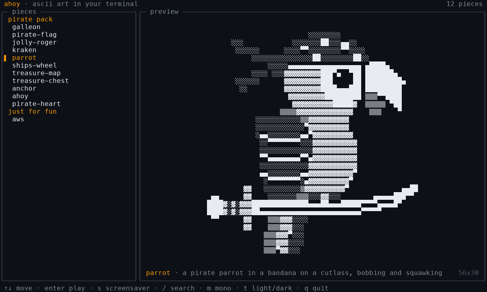
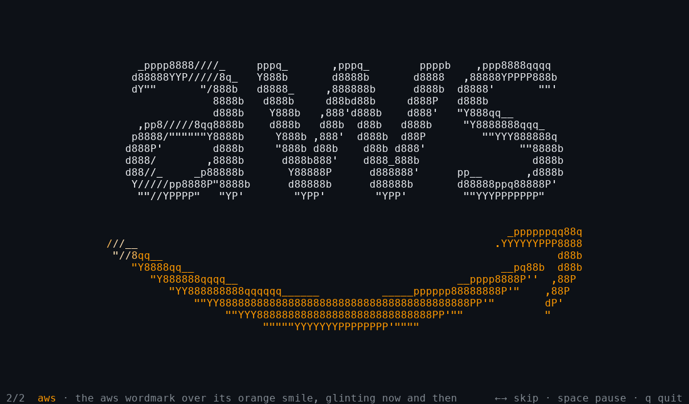

# ahoy

Animated ascii art in your terminal: 124 pirate pieces in five packs, the original *pirate pack*, *pirate pixels* (pixel art in a few flat colours), *jolly rogers* (two dozen takes on the skull and crossbones), *pirate lore* (animated logos from the golden age of piracy) and *pirate scenes* (big painted halftone scenes), plus the AWS logo, just for fun. Browse them with a live preview, play one full screen, or leave a screensaver running.

The pieces are built on [ascii.rest](https://github.com/bas3line/ascii), and its library of 200+ more pieces is a flag away: `--all`.



## Install

On macOS or Linux:

```sh
curl -fsSL https://raw.githubusercontent.com/mza/ahoy/main/install.sh | sh
```

This downloads a single standalone binary for your machine (Apple silicon or Intel Mac, Linux x64 or arm64, glibc or musl), checks it against the release's checksums, and puts it in `~/.local/bin`. You don't need Node or anything else installed.

To pick the version or the location:

```sh
curl -fsSL https://raw.githubusercontent.com/mza/ahoy/main/install.sh | AHOY_VERSION=v0.1.0 AHOY_BIN_DIR=/usr/local/bin sh
```

To uninstall, delete the binary: `rm ~/.local/bin/ahoy`.

## Use

```sh
ahoy                             # pick a piece; the one under the cursor plays as you go
ahoy kraken                      # play one full screen
ahoy galleon pirate-flag aws     # play a few, ←/→ to move between them
ahoy saver                       # screensaver: every piece, one after another
ahoy saver --shuffle -d 30       # in a random order, 30 seconds each
ahoy saver galleon,kraken,aws    # just these
ahoy saver pirate scenes --all   # the pirate pack and the library's scenes
ahoy list                        # every piece, by group
ahoy --all                       # the picker, with the ascii.rest library too
```

A selection can name pieces (`galleon`), groups (`pirate`, `pixels`, `rogers`, `lore`, `voyages`, `aws`) or `all`, separated by spaces or commas. Pieces and groups from the [ascii.rest library](https://ascii.rest) (`donut`, `scenes`, `logos`, `distros`, ...) can be named too; with `--all` they're also listed in the picker, in `ahoy list` and under `all`.

The screensaver shows no text unless you press a key, and puts each piece somewhere different on the screen, so nothing burns in.



| Key | Picker | Player and screensaver |
| --- | --- | --- |
| `↑` `↓` / `j` `k` | move | |
| `PgUp` `PgDn` `g` `G` | jump | |
| `enter` | play the piece and the ones listed with it | |
| `/` | search names and descriptions | |
| `x` | mark a piece for the screensaver | |
| `s` | screensaver over the marked pieces, or everything listed | |
| `←` `→` | | previous, next |
| `space` | pause the preview | pause |
| `,` `.` | a frame back or on (pauses) | same |
| `e` | when paused, save the frame as pictures | same |
| `m` | coloured pieces in one colour | same |
| `t` | colours for a light or dark terminal | same |
| `q` / `esc` | quit | back to the picker, or quit |

| Option | |
| --- | --- |
| `-d`, `--dwell <seconds>` | how long the screensaver shows each piece (default 15) |
| `-s`, `--shuffle` | screensaver in a random order |
| `-m`, `--mono` | coloured pieces in the terminal's own colour |
| `-l`, `--light` | for a light terminal |
| `-a`, `--all` | list the ascii.rest library too |
| `-o`, `--out <folder>` | where `e` saves a paused frame (default: the folder you are in) |

Most pieces are up to 80×32, and the scenes are shrunk to fit. In a smaller terminal, pieces drawn in blocks or dense fill are shrunk to fit, and line art is cropped to its middle rather than torn. Coloured pieces need a terminal with truecolor (iTerm2, Ghostty, WezTerm, kitty, Alacritty, Windows Terminal); elsewhere, use `--mono`. When the output isn't a terminal, `ahoy <piece>` prints the piece's first frame as plain text: `ahoy galleon > galleon.txt`.

### Saving a frame

Pause a piece with `space`, step to the frame you want with `,` and `.`, and press `e`. ahoy saves that frame twice, 1500 pixels square: `ahoy-<piece>-<frame>.png`, with nothing behind the piece, and `ahoy-<piece>-<frame>.jpg`, on the piece's own ground. It is the piece at its full size, as large as whole pixels allow, whatever the size of your terminal, in the look you were watching it in (`m` for one ink, `t` for a light page). Letters are drawn in a small bitmap font of ahoy's own, since there is no terminal font in a picture.

## The pieces

There are contact sheets of every piece in [`docs/sheets`](docs/sheets).

**pirate pixels** (`pixels`): `sea-dog`, `sea-dog-2`, `doubloon`, `lit-fuse`, `dead-eye`, `gold-tooth`, `skull-candle`, `fish-bones`, `crossed-cutlasses`, `dagger`, `cannon`, `skeleton-key`, `tricorn`, `rum-bottle`, `x-marks-the-spot`, `desert-island`, `sloop`, `jolly-boat`, `ship-in-a-bottle`, `walk-the-plank`, `shark-fin`, `whale-tail`, `sea-serpent`, `octopus`, `pirate-crab`, `seagull`, `pirate-captain`, `man-of-war`, `ships-monkey`, `bilge-rat`, `anglerfish`, `mermaid`, `kraken-arms`, `flintlock`, `gold-hoard`, `brass-compass`, `grappling-hook`, `oyster-pearl`. Pixel art drawn in half blocks, two square pixels a cell, each pixel drawn on its own, in a few flat colours on black.

**jolly rogers** (`rogers`): `skull-and-crossbones`, `jack-rackham`, `cutlass-bite`, `pierced-skull`, `crowned-skull`, `fire-roger`, `red-roger`, `ghost-roger`, `laughing-roger`, `rose-roger`, `profile-roger`, `winged-skull`, `emanuel-wynne`, `henry-every`, `condent-pennant`, `gold-roger`, `flintlock-roger`, `anchor-roger`, `shovel-roger`, `storm-roger`, `ice-roger`, `snake-roger`, `spider-roger`, `drowned-roger`. Two dozen takes on the skull and crossbones, or crossed cutlasses, drawn the same way.

**pirate lore** (`lore`): `blackbeard`, `calico-jack`, `queen-annes-revenge`, `black-bart`, `pieces-of-eight`, `no-prey-no-pay`, `tortuga`, `hourglass`, `black-spot`, `flying-dutchman`, `compass-rose`, `wanted-poster`, `eight-bells`, `stede-bonnet`, `ghost-captain`, `cutlass`, `broadside`, `dead-mans-chest`, `grog`, `davy-jones-locker`, `spyglass`, `iron-hook`, `skull-moon`, `edward-low`, `thomas-tew`, `ships-lantern`, `three-skulls`, `articles`, `powder-keg`, `joli-rouge`, `crossed-flintlocks`, `crows-nest`, `message-in-a-bottle`. Animated logos in terminal character art on black, most of them historical pirate flags and the stuff of pirate legend.

**pirate scenes** (`voyages`): `skull-island`, `storm-at-sea`, `port-royal`, `pirate-cove`, `glowing-wake`, `sea-battle`, `burning-ship`, `masthead-dawn`, `sunken-galleon`, `wreck-coast`, `treasure-cave`, `pirate-tavern`, `kraken-rising`, `ghost-ship`, `hidden-lagoon`, `aurora-passage`, `volcano-isle`, `lighthouse-reef`. 200×100 halftone scenes in colour, in the style of ascii.rest's own; in a terminal they're shrunk to fit, so they look best in a big window, or full screen in the macOS screensaver.

**the pirate pack** (`pirate`):
`galleon`, `pirate-flag`, `jolly-roger`, `kraken`, `parrot`, `ships-wheel`, `treasure-map`, `treasure-chest`, `anchor`, `ahoy` and `pirate-heart`, each in a different style: dense ascii fill, box-drawing line art, old-school slashes, shaded blocks, procedural shading. They live in [`src/pieces`](src/pieces) and follow the [ascii.rest piece contract](https://github.com/bas3line/ascii/blob/main/CONTRIBUTING.md), so any of them could be contributed upstream.

## Develop

You need Node 23.6 or later, which runs the TypeScript directly, and [Bun](https://bun.sh) to build the binary.

```sh
npm install
npm start                 # the picker, from source
npm start -- saver        # or any other arguments
npm run typecheck
npm run build             # dist/ahoy, a standalone binary for this machine
```

How the pieces were made, and how to make more, is in [docs/MAKING-PIECES.md](docs/MAKING-PIECES.md). To add a piece, put it in `src/pieces/` and list it in [`src/own.ts`](src/own.ts); the terminal app and the screensaver both play that list. Don't put non-ascii characters in a `String.raw` template: Bun's bundler escapes them, and the binary would print `\u2591` instead of `░`. Use a plain template, and CI checks for it.

## macOS screensaver

[`macos/`](macos) builds `Ahoy.saver`, a native screensaver that plays the same pieces full screen: `npm run saver`, then double-click `macos/build/Ahoy.saver`. See [macos/README.md](macos/README.md).

## Release

Bump `version` in `package.json`, then push a matching tag:

```sh
git tag v0.1.0 && git push origin v0.1.0
```

[`release.yml`](.github/workflows/release.yml) then builds the six binaries (macOS ones on a macOS runner), writes `SHA256SUMS`, and publishes the GitHub release that `install.sh` downloads.

## Credits

The library pieces and the terminal painter come from [ascii.rest](https://github.com/bas3line/ascii) by [@bas3line](https://github.com/bas3line), MIT licensed. The AWS logo is a trademark of Amazon.com, Inc. or its affiliates; other logos are trademarks of their owners. See [NOTICE](NOTICE).

ahoy is MIT licensed; see [LICENSE](LICENSE).
